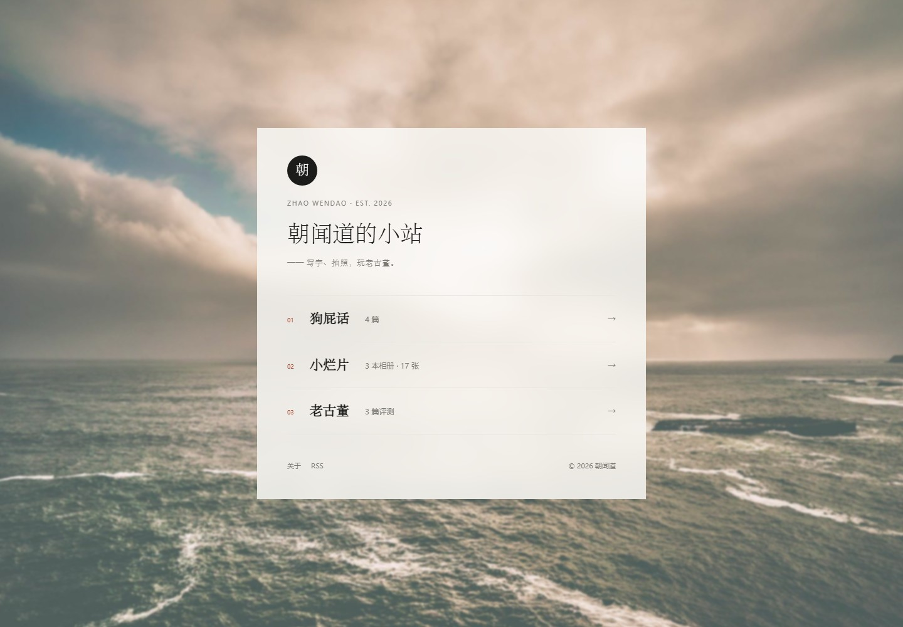

# 朝闻道的小站

一个极简的个人博客：写点小作文，放些照片，聊聊相机和镜头。

首页是「朝闻道的小站」，上面三个入口：狗屁话、小烂片、老古董，各自一套侧栏和页面，内容互不混在一起。

纯静态、零依赖。所有页面由 `node build.mjs` 从 Markdown 生成，托管在 GitHub Pages。



## 本地预览

需要 Node.js 18 或更高版本。

```bash
node build.mjs
node serve.mjs
```

打开 <http://127.0.0.1:4321>。

也可以直接双击 `本地预览.bat`：会自动构建、启动服务器并打开浏览器；关掉那个黑窗口就停止服务器。

> 不要直接双击 `dist/index.html`。站点用的是 `/assets/...` 这种绝对路径，`file://` 打开会丢样式和图片，必须走本地服务器。

边写边看：

```bash
node build.mjs
node serve.mjs --watch
```

也可以 `npm run dev`。这台机器上如果 npm 报「禁止运行脚本」，用上面的 `node` 命令，或者 `npm.cmd run dev`。

## 有什么

- 首页：朝闻道的小站 + 三个入口（狗屁话 / 小烂片 / 老古董），纯白背景
- 狗屁话：自己的侧栏、置顶短文、文章列表、文章页、归档
- 小烂片：自己的侧栏、置顶短文、相册方格、灯箱（滚轮缩放、单击 1x/3x 切换、左键拖动）
- 老古董：自己的侧栏、置顶短文、评分、优缺点、规格表
- RSS、404、手机适配
- 深浅两套配色：默认跟随系统，页脚可以手动切，选择会记住
- 没有评论、搜索——保持简单

文章页会自动归到「狗屁话」，`type: review` 的评测归到「老古董」，相册归到「小烂片」，三者不会混在一起。

## 写文章

完整的字符格式、图片、注释、表格写法见 [`templates/文章范式.md`](templates/文章范式.md)。下面是最小示例。

在 `content/posts/` 新建 `.md`，**文件名就是网址**：

```markdown
---
title: 在雨天整理书架
date: 2026-10-18
category: 日常
tags: [生活, 阅读]
cover: /images/covers/rain.jpg
summary: 一句话摘要。
---

正文。

## 小标题

段落。
```

正文里直接按回车就是单行换行；空一行才是新段落。

### 注释

两种写法，都会变成细斜的宋体注释字：

- **行内**：`*这几个字是注释*`（也可以用 `_这几个字是注释_`）
- **整段**：把一整段用【】括起来，会渲染成小一号、灰色的细斜注释块，左边一道细线

```markdown
他吹嘘自己去过京都。*——其实只是睡了一夜船。*

【此处是整段注释，可以很长，也可以换行。】
```

中文没有真正的斜体，浏览器是把字向右倾斜（伪斜）；宋体笔画本来就细，斜过来正好是注释的观感，西文则用 Georgia 的真斜体。

| 字段 | 必填 | 说明 |
| --- | --- | --- |
| `title` | 是 | 标题 |
| `date` | 是 | `YYYY-MM-DD` |
| `category` | 否 | 分类，显示在列表和文章顶部 |
| `tags` | 否 | 标签，文章底部显示 |
| `cover` | 否 | 封面图，文章页顶部显示 |
| `summary` | 否 | 摘要，显示在列表和分享卡片 |
| `type` | 否 | 默认 `essay`；老古董评测写 `review` |
| `draft` | 否 | `true` 时不生成 |

老古董评测再加一段：

```yaml
type: review
verdict: 一句话结论。
gear:
  kind: 镜头
  brand: 富士
  model: XF 33mm F1.4 R LM WR
  mount: X-Mount
  price: 5299
  score: 9.2
  duration: 8 个月
  pros:
    - 全开光圈就能用
    - 对焦安静
  cons:
    - 有点重
  specs:
    焦段: 33mm
    重量: 360g
```

## 建相册

### 最省事：拖文件夹导入

1. 建一个文件夹，**文件夹名就是相册标题**，比如 `青岛`，把照片放进去。
2. 把这个文件夹拖到根目录的 `导入照片.bat` 上。
3. 它会自动把照片复制到 `public/images/albums/青岛/`，并生成 `content/albums/青岛.md`；文件名当图注，第一张当封面。相册页会自动读取每张照片的 EXIF，在图片下面显示焦距、光圈、快门、ISO。
4. 打开生成的 md，改一下 `location` 和相册介绍就行；`camera` / `lens` 可以留空。

如果相册已经存在，再拖一次会往后追加照片。

相册是自适应网格：保持照片原比例，一行最多 4 张，同一行等高；窄屏会自动减少每行的张数。相册内的照片默认按 EXIF 拍摄时间排序，没有 EXIF 时按文件名自然排序，不用手动调整 Markdown 里的顺序。

如果某一册想严格按 Markdown 里的顺序排，在相册 frontmatter 加：

```yaml
sort: manual
```

如果只想把某几张固定到最前或最后，其余照片仍然按时间排：

```yaml
pinTop:
  - 03.jpg
pinBottom:
  - 13.jpg
```

`pinTop` 里的照片按列表顺序排在最前，`pinBottom` 里的排到最后；填文件名或完整路径都可以。

也可以在命令行运行：

```bash
node tools/import-album.mjs "D:\照片\青岛"
```

### 手动建

在 `content/albums/` 新建 `.md`：

```markdown
---
title: 海边的下午
date: 2026-09-14
location: 北方海岸
camera: Fujifilm X-T5
lens: XF 23mm F1.4 R LM WR
cover: /images/albums/sea/01.jpg
---

那天风很大。


```

`alt` 是图注，引号里的 `title` 只在照片没有 EXIF 时作为备用信息。

相册页会自动读取照片的 EXIF，在每张图下面显示：

```
焦距 · 光圈 · 快门 · ISO
```

EXIF 读不到时，才依次用 Markdown 的 `title`、`alt` 兜底。

模板在 `templates/`，直接复制改。

## 彩蛋：filia

首页头像现在点进 `/secret/filia/`，是一个不在导航里的专辑页：

- 页面内容在 `lib/pages.mjs` 的 `filiaPage`
- 封面是 `public/images/music/filia.jpg`
- 首页点avatar 是页面内 overlay，圆形展开进入；直接访问 `/secret/filia/` 也有独立页
- 「播放整张」会打开网易云音乐专辑页（ID `90662216`）；iframe 在部分浏览器里会报「资源加载失败」，所以不做页面内嵌
- 页面标了 `noindex`，不会进 sitemap

不想保留彩蛋：把 `build.mjs` 里「彩蛋：filia」那段路由删掉，再把 `homePage` 里头像的链接改回 `/`。

## 换头像

首页那个方形头像，默认是「朝」字。换成自己的照片：

1. 双击根目录的 `换头像.bat`，选一张图；也可以直接把图片拖到这个文件上。
2. 它取图片**中间的正方形**，缩放到 256×256，存成 `public/images/site/avatar.jpg`，然后自动重新构建。

透明 PNG 会铺成站点卡片的米白底色（`#fbfbf9`），不会变成黑底。

想变回「朝」字：删掉 `public/images/site/avatar.jpg` 重新构建即可。想用别的路径，改 `site.config.mjs` 里的 `avatar`。

命令行等价写法：

```bash
powershell -NoProfile -ExecutionPolicy Bypass -File tools\set-avatar.ps1 -Path "D:\照片\我.jpg"
```

图片本来不是正方形也没关系：构建出来的头像是正方形文件，页面里按 `object-fit: cover` 居中显示，不会拉变形。

## 三个分栏的置顶短文

每个分栏顶部都有一块「置顶」，只放一小段不带图片的文字：

- `content/pinned/essays.md`（狗屁话）
- `content/pinned/photos.md`（小烂片）
- `content/pinned/gear.md`（老古董）

改完重新构建即可。置顶内容不会进入文章列表、归档或 RSS。

## 导出全站文本

运行：

```bash
node tools/export-text.mjs
```

会把首页、三个分栏、关于页、归档页和 404 的可见文本汇总到 `docs/全站文本.md`，方便通读和统一改写。

这是汇总副本，不是构建源文件；改它不会更新网站。真正的源文件仍在 `content/` 和 `site.config.mjs`。

## 改站点

打开 `site.config.mjs` 改：

- 站点名、作者、邮箱
- 首页标题和签名（`fullTitle` / `signature`）
- 三个分栏的名字、简介、导航（`sections`）
- 首页背景（`portalPhotos`）：现在留空，首页是纯白的；填回图片路径就会恢复背景轮播，样式和脚本都还在
- 社交链接（GitHub / Bilibili 的示例已经注释掉）
- 在用的老古董

颜色和字体在 `assets/style.css` 顶部的 `:root` 里；三个分栏的强调色在 `site-essays / site-photos / site-gear` 三个类里。

## 深浅色

页面有两套配色，靠 CSS 变量切换：浅色在 `:root`，深色在 `[data-theme="dark"]`，各改一处就行，规则本身不用动。

- 默认跟随系统（`prefers-color-scheme`）
- 页脚那个月亮／太阳图标可以手动切，选择存在 `localStorage` 的 `theme` 里，以后优先用它
- 系统切换深浅色时，如果没手动选过，页面会跟着变
- 深色下三个分栏的强调色单独调亮过，在 `[data-theme="dark"] .site-essays` 那几行

想让站点永远浅色、不跟系统：把 `lib/render.mjs` 里 `themeBoot` 的判断改成 `t = "light"`，同时删掉 `assets/main.js` 末尾那个 `media.addEventListener` 就行。

## 图片

放在 `public/images/`，引用时写 `/images/...`。

- 封面：1600×1000 左右
- 相册缩略图：`thumbs/`，长边 800px；网格用
- 相册大图：`large/`，长边 3000px；灯箱用
- 相册原图：`full/`；灯箱里点「下载原图」
- 正文图：长边 1600px，JPEG 质量 85
- 正文大图：`public/images/large/` 下同样相对路径，长边 3000px；灯箱用
- 正文原图：`public/images/full/`，灯箱里点「下载原图」

构建时会自动识别这些文件；没有就退回当前图片。缩略图/大图/原图本身需要提前生成，构建不会自动压缩。
- 首页背景：从 `portalPhotos` 里选，建议 1600–2000px 宽，横竖构图都可以
- 不需要单独准备首页大图

构建时会自动读取图片尺寸；不会压缩图片，上传前用 [Squoosh](https://squoosh.app/) 压一下。

> 现在的文章、评测和照片都是占位示例（照片来自 Lorem Picsum）。换成自己的内容时，直接改 Markdown 和 `public/images/` 即可。

## 目录

```
build.mjs            生成器
serve.mjs            本地预览
site.config.mjs      站点信息
content/posts/       文章与评测
content/albums/      相册
content/pinned/      三个分栏的置顶短文
content/pages/       关于页
public/images/       图片
assets/              样式和灯箱脚本
templates/           写作模板
tools/               照片导入脚本、头像裁切脚本
换头像.bat            选一张图当首页头像（自动裁成中心正方形）
导入照片.bat          把文件夹拖上来，批量导入相册
dist/                构建产物
```

## 部署

完整步骤见 [DEPLOY.md](DEPLOY.md)：建仓库、开 GitHub Pages、在阿里云配 DNS、等 HTTPS。

简单说：推到 GitHub，Pages 来源选 **GitHub Actions**，Settings 里填 `zhaowendao1997.cn`，阿里云加 A / AAAA / CNAME 记录。
